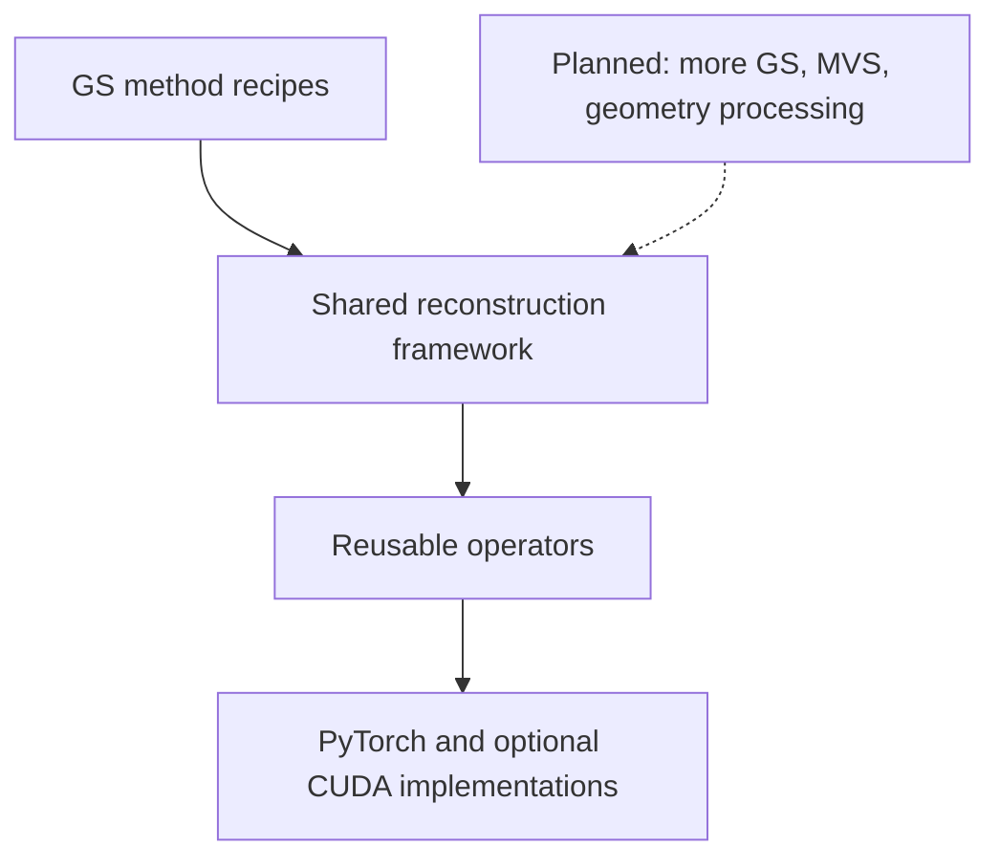

# SplatForge

**Reusable operators and a modular framework for Gaussian Splatting and 3D reconstruction research.**

*Reproduce. Decompose. Recombine.*

SplatForge is building a common toolbox for developing reconstruction methods.
We start with geometry-oriented Gaussian Splatting: turn the geometry,
rendering, and optimization components behind individual methods into
operators that researchers can inspect, test, and reuse.

The goal is to take an idea from one paper, bring it into another method, and
evaluate the change within the same research workflow. As the foundations
develop, we plan to extend the toolbox to more GS methods, multi-view stereo,
and geometry processing.

**Current stage: early prototype (`0.0.1a1`).** This repository is the first
public code preview of that direction. Interfaces are still evolving.

## Why build this?

Moving a depth constraint, densification rule, or surface extraction idea into
a new method can require changes across its renderer, representation, trainer,
and evaluation code. SplatForge aims to give those components explicit
boundaries so that an experiment can focus on the idea being tested.

Three goals guide the project:

- **Reproduce:** exercise selected methods in a shared workflow and understand
  their numerical behavior.
- **Decompose:** expose useful components as operators with documented tensor
  semantics and gradients.
- **Recombine:** make it easier to replace components and test new combinations
  across methods. Broad compatibility is a development goal.

## What we are building

| Layer | Purpose |
| --- | --- |
| **Operator library** | Reusable geometry, rendering, matching, and optimization building blocks with explicit contracts and independently testable implementations |
| **Research framework** | Shared scene loading, training, checkpoints, evaluation, visualization, and geometry export for exercising those building blocks |
| **Method recipes** | Concrete combinations of representations, renderers, losses, and training schedules that test and inform the abstractions |



The longer-term ambition is a reconstruction toolbox where a new method can
reuse existing infrastructure and contribute useful components back to the
library. Geometry GS is the starting point for building and testing it.

## From this prototype to a reconstruction toolbox

| Stage | Focus |
| --- | --- |
| **Now — feasibility** | Implement selected methods and operators, test their behavior, and explore which abstractions support reuse |
| **Next — framework and operator library** | Develop a usable GS research framework, a documented operator set, extension examples, and validated execution backends |
| **Later — broader reconstruction tooling** | Extend to additional GS methods, selected MVS components, and point-cloud and mesh processing |

These are development goals. The current prototype is the starting point.
See the [roadmap](docs/ROADMAP.md) for what each stage is intended to deliver.

## Explore the code

The current source includes three experimental Studio recipes and an
independent companion containing Unbiased Surfel and PGSR-style auxiliaries.

| Source | Start here |
| --- | --- |
| [Gaussian operators](src/splatforge/gaussian/) | Versioned entry points and [tensor contracts](src/splatforge/gaussian/semantics.json) |
| [Torch providers](src/splatforge/providers/torch/gaussian/) | Covariance, ray geometry, SH, compositing, depth distortion, ambiguity, opacity fields, and patch ZNCC |
| [Method recipes](src/splatforge/studio/methods/) | RaDe-GS, AmbiSuR, and GOF configurations and pipeline factories |
| [Studio](src/splatforge/studio/) | Data, representations, training, resume, evaluation, viewer, and exporters |
| [Core runtime](src/splatforge/core/) | Contracts, registries, provider capabilities, dispatch, and execution policy |
| [Mesh utilities](src/splatforge/mesh/) | Tetrahedral extraction and geometry I/O |
| [Independent companion](commercial_unbiased_gsplat/) | Unbiased Surfel and PGSR-style operators, installed separately from Studio |
| [Tests](tests/) | Operator behavior, gradients, component integration, and synthetic workflows |

RaDe-GS optionally integrates a pinned gsplat port. AmbiSuR and GOF use
experimental paper-derived Torch compositions. The companion is not registered
as additional Studio methods. Scope and source details are in the
[Studio guide](docs/studio/PUBLIC_GUIDE.md) and [dependency notes](THIRD_PARTY.md).

## Try an operator

```python
import torch
from splatforge.gaussian import SurfaceOperators

ops = SurfaceOperators()
quaternions = torch.tensor([[1.0, 0.0, 0.0, 0.0]], requires_grad=True)
scales = torch.tensor([[0.1, 0.2, 0.3]], requires_grad=True)
covariance = ops("gaussian.covariance@1", quaternions, scales)
covariance.square().sum().backward()
```

Operator contracts are recorded in
[`semantics.json`](src/splatforge/gaussian/semantics.json).
The runtime rejects unsupported calls explicitly; backend substitutions are
not hidden behind the API.

## Run from source

Use Python 3.10 or later in a dedicated environment. Install a PyTorch build
appropriate for your machine, then clone and install the source:

```bash
git clone https://github.com/KCBtheone/SplatForge.git
cd SplatForge
python -m pip install -e '.[studio]'
splatforge methods
```

To exercise the shared workflow on a small CPU example:

```bash
splatforge demo --output demo-data --width 24 --points 48
sf-train gof --data demo-data --output outputs/demo --device cpu --backend torch \
  --steps 3 --set data.downscale=1 --set data.init_points=48 \
  --set model.opacity=0.7 --set densify.enabled=false \
  --set loss.geometric_start=0 --set train.export_on_finish=false
sf-export --run outputs/demo --device cpu \
  --set export.alpha_min=0.1 --set export.truncation=0.15
sf-viewer --run outputs/demo --device cpu
```

The demo uses an analytic sphere and generated images to exercise the workflow.
The commands use Bash line continuation; in PowerShell, put each command on
one line or use a backtick for continuation.

## Development status

The prototype includes local tests and CPU CI for operators and synthetic
workflows. Paper benchmark parity, real-scene quality acceptance, and arbitrary
cross-method compatibility are not established by those checks. Accelerated
backends require their own numerical and performance validation.

The [source preview](https://github.com/KCBtheone/SplatForge/releases/tag/v0.0.1a1)
provides a versioned code snapshot and validation record. Optional installable
packages are available there as a convenience.

## Documentation and development

- [Studio guide](docs/studio/PUBLIC_GUIDE.md): inputs, backends, plugins, and exports.
- [Architecture](ARCHITECTURE.md): design direction; some sections describe planned work.
- [Roadmap](docs/ROADMAP.md): feasibility work, the first operator library, and later expansion.
- [Source and dependency notes](THIRD_PARTY.md).
- [Preview release notes](docs/releases/0.0.1a1.md).
- [Contributing](CONTRIBUTING.md).

For the source checks:

```bash
python -m pip install -e '.[studio,test]'
python tools/quality/run_phase0_checks.py
```

The `Phase 0` name refers to the feasibility stage and its local checks, not a
completed paper reproduction. CUDA backends require separate environment and
GPU validation. The current release verification is described in the release
notes.

## License

SplatForge's original source is licensed under [Apache-2.0](LICENSE).
Optional dependencies retain their own licenses and notices. See
[NOTICE](NOTICE) and [THIRD_PARTY.md](THIRD_PARTY.md) for attribution and the
scope of this source distribution.
