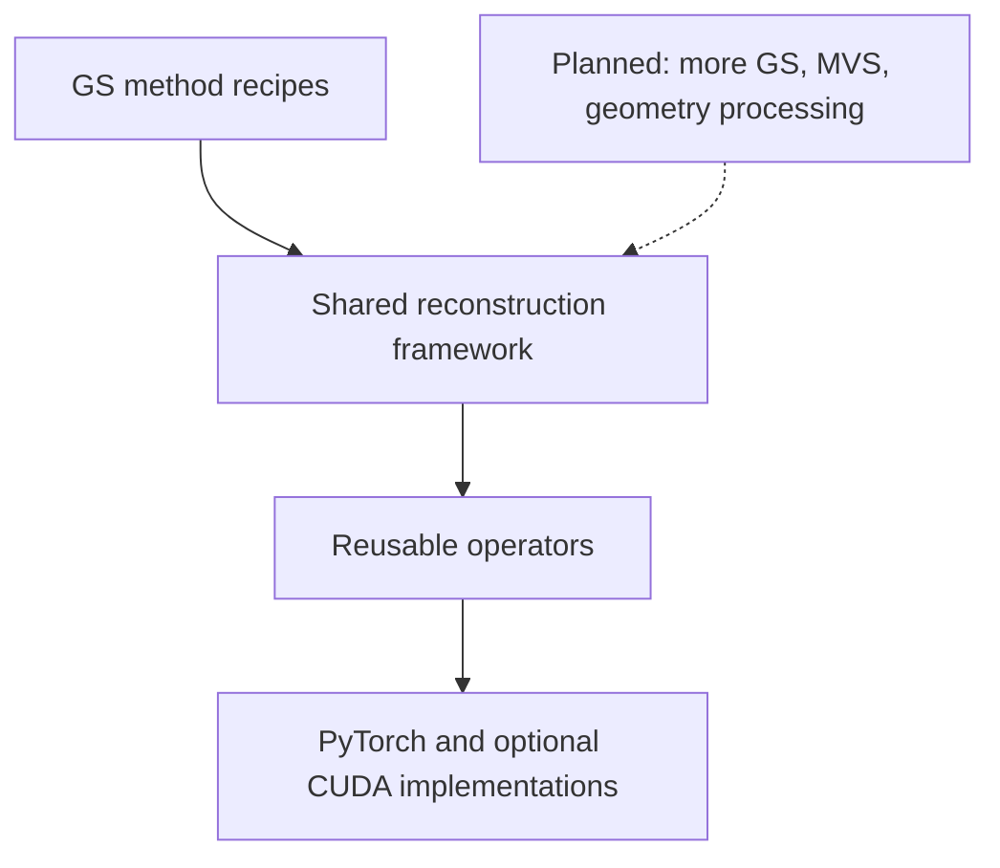

# SplatForge

SplatForge provides geometry, rendering, and optimization operators for
Gaussian Splatting. Studio uses them in a shared workflow for training,
evaluation, and surface extraction.

The `0.0.1a2` source preview includes experimental method recipes. Interfaces
are still evolving.

## What we are building

| Layer | Purpose |
| --- | --- |
| **Operator library** | Reusable geometry, rendering, matching, and optimization building blocks with explicit contracts and independently testable implementations |
| **Research framework** | Shared scene loading, training, checkpoints, evaluation, visualization, and geometry export for exercising those building blocks |
| **Method recipes** | Concrete combinations of representations, renderers, losses, and training schedules that test and inform the abstractions |



The longer-term ambition is a reconstruction toolbox where a new method can
reuse existing infrastructure and contribute useful components back to the
library. Geometry GS is the starting point for building and testing it.

## From this prototype to a reconstruction toolbox

| Stage | Focus |
| --- | --- |
| **Now — feasibility** | Implement selected methods and operators, test their behavior, and explore which abstractions support reuse |
| **Next — framework and operator library** | Develop a usable GS research framework, a documented operator set, extension examples, and validated execution backends |
| **Later — broader reconstruction tooling** | Extend to additional GS methods, selected MVS components, and point-cloud and mesh processing |

These are development goals. The current prototype is the starting point.
See the [roadmap](docs/ROADMAP.md) for what each stage is intended to deliver.

## Explore the code

Studio includes experimental RaDe-GS, AmbiSuR, GOF, MILo, VCR-GauS, PGSR,
and Unbiased Surfel recipes.

| Source | Start here |
| --- | --- |
| [Gaussian operators](src/splatforge/gaussian/) | Versioned entry points and [tensor contracts](src/splatforge/gaussian/semantics.json) |
| [Torch providers](src/splatforge/providers/torch/gaussian/) | Covariance, ray geometry, SH, compositing, depth distortion, ambiguity, opacity fields, and patch ZNCC |
| [Method recipes](src/splatforge/studio/methods/) | Studio presets and training backends |
| [Studio](src/splatforge/studio/) | Data, representations, training, resume, evaluation, viewer, and exporters |
| [Core runtime](src/splatforge/core/) | Contracts, registries, provider capabilities, dispatch, and execution policy |
| [Mesh utilities](src/splatforge/mesh/) | Tetrahedral extraction and geometry I/O |
| [CUDA companion](commercial_unbiased_gsplat/) | Standalone operator package and Unbiased Surfel CUDA sources |
| [PGSR and Unbiased Surfel setup](docs/releases/pgsr-preview.md) | COLMAP input, CUDA dependencies and TSDF mesh export |
| [Tests](tests/) | Operator behavior, gradients, component integration, and synthetic workflows |

RaDe-GS optionally integrates a pinned gsplat port. AmbiSuR and GOF use
paper-derived Torch operators. MILo uses reference implementations for mesh
topology and rasterization. See the [Studio guide](docs/studio/PUBLIC_GUIDE.md)
and [dependency notes](THIRD_PARTY.md) for the requirements of each recipe.

## Try an operator

```python
import torch
from splatforge.gaussian import SurfaceOperators

ops = SurfaceOperators()
quaternions = torch.tensor([[1.0, 0.0, 0.0, 0.0]], requires_grad=True)
scales = torch.tensor([[0.1, 0.2, 0.3]], requires_grad=True)
covariance = ops("gaussian.covariance@1", quaternions, scales)
covariance.square().sum().backward()
```

Operator contracts are recorded in
[`semantics.json`](src/splatforge/gaussian/semantics.json).
The runtime rejects unsupported calls explicitly; backend substitutions are
not hidden behind the API.

## Run from source

Use Python 3.10 or later in a dedicated environment. Install a PyTorch build
appropriate for your machine, then clone and install the source:

```bash
git clone https://github.com/KCBtheone/SplatForge.git
cd SplatForge
python -m pip install -e '.[studio]'
splatforge methods
```

To exercise the shared workflow on a small CPU example:

```bash
splatforge demo --output demo-data --width 24 --points 48
sf-train gof --data demo-data --output outputs/demo --device cpu --backend torch \
  --steps 3 --set data.downscale=1 --set data.init_points=48 \
  --set model.opacity=0.7 --set densify.enabled=false \
  --set loss.geometric_start=0 --set train.export_on_finish=false
sf-export --run outputs/demo --device cpu \
  --set export.alpha_min=0.1 --set export.truncation=0.15
sf-viewer --run outputs/demo --device cpu
```

The demo uses an analytic sphere and generated images to exercise the workflow.
The commands use Bash line continuation; in PowerShell, put each command on
one line or use a backtick for continuation.

## Development status

The optional [CPU mesh processing layer](docs/mesh/PROCESSING.md) includes
clipping and capping, boundary patches, topology and intersection checks,
constrained smoothing, and quadric error simplification.

The prototype includes local tests and CPU CI for operators and synthetic
workflows. Paper benchmark parity, real-scene quality acceptance, and arbitrary
cross-method compatibility are not established by those checks. Accelerated
backends require their own numerical and performance validation.

The [source preview](https://github.com/KCBtheone/SplatForge/releases/tag/v0.0.1a2)
provides the source tree, Python source distribution, and installable wheel.

## Documentation and development

- [Studio guide](docs/studio/PUBLIC_GUIDE.md): inputs, backends, plugins, and exports.
- [Studio architecture](docs/adr/0004-modular-surface-studio.md).
- [Roadmap](docs/ROADMAP.md): feasibility work, the first operator library, and later expansion.
- [Source and dependency notes](THIRD_PARTY.md).
- [Preview release notes](docs/releases/0.0.1a2.md).
- [Preparing a public preview](docs/releases/README.md).
- [Contributing](CONTRIBUTING.md).

For the source checks:

```bash
python -m pip install -e '.[studio,test]'
python tools/quality/run_phase0_checks.py
```

The Phase 0 checks cover the feasibility-stage implementation. CUDA backends
require separate environment and GPU validation. The release notes describe
verification for the tagged `v0.0.1a2` release.

## License

SplatForge's original source is licensed under [Apache-2.0](LICENSE).
Optional dependencies retain their own licenses and notices. See
[NOTICE](NOTICE) and [THIRD_PARTY.md](THIRD_PARTY.md) for attribution and the
scope of this source distribution.
